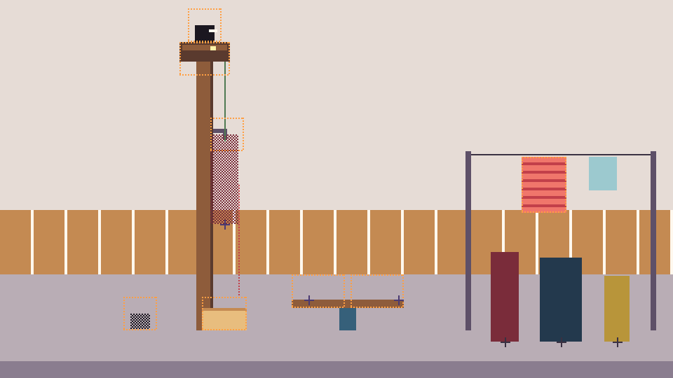
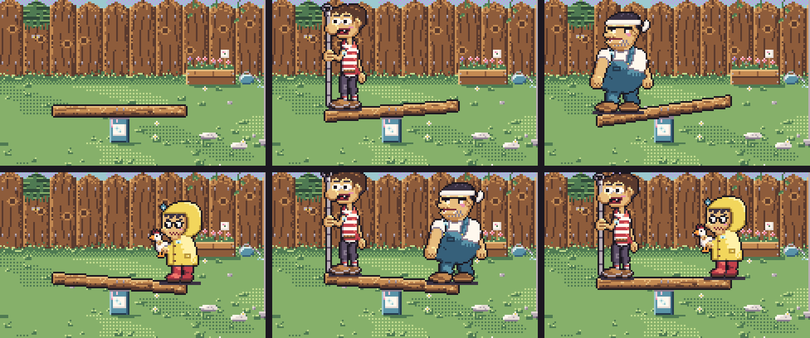

# 화면 1 상세 설계: `magpie_nest` 빨랫대 까치 둥지

- 작성: **[디자이너 Luna]**, 2026-11-15
- 상태: 초안 (이슈 #66, M1 임계 경로 3번)
- 근거: ADR-0003(예시 퍼즐, 능력 표), ADR-0018(퍼즐 원칙 M·S·F·G·R·I), ADR-0007(결정 6 히트 영역, 결정 11 크기표), [재미 체크리스트](../fun-checklist.md)(#71), [MVP 화면 매트릭스](../mvp-screen-matrix.md) 4번
- 배치도: `magpie_nest-layout-2x.png` (생성·검사: `node docs/design/screens/magpie_nest-layout.mjs`. 설계 숫자를 어기면 종료 코드 1)
- **이 문서가 정하는 것**: 핫스팟·서는 자리·좌표, 규칙 목록(순서 있음), 캐릭터×대상 반응 전체, 대사, 힌트, `solution`, 고유 애니메이션 목록.
- **정하지 않는 것**: JSON 필드 이름과 ID 문법(#65 데이터 모델 ADR). #65가 머지되면 이 문서를 JSON으로 옮긴다. 이 문서의 ID는 #65 문법에 맞춰 바뀔 수 있고, **JSON이 main에 머지되는 순간부터** ADR-0018 I2(이름 안 바꿈)가 적용된다.

## 한 줄 요약
까치가 빨래방 열쇠를 빨랫대 꼭대기 둥지에 넣어 뒀다. 삑삑이가 고무 닭으로 까치를 바닥에 불러 내리고, 묵직이가 시소를 쿵 찧어 쭉이를 고리에 매단다. 매달린 쭉이가 장대를 뻗어 열쇠를 집으면 클리어다. 클리어 순간 까치가 이번엔 쭉이 장대의 반짝이는 집게를 노린다.

## 1. 배치 (480×270 내부 px)



배치도 읽는 법: 주황 점선 = 히트 영역, 보라 `+` = 서는 자리, 진보라 `+` = 시작 위치, 체크무늬 = 상태가 바뀐 뒤 위치(바닥의 까치, 고리에 매달린 쭉이), 초록 세로줄 = 고리에서 둥지까지 장대(닿음), 빨강 점선 = 땅에서 뻗은 최대 길이(모자람).

### 1-1. 핫스팟

그림 크기는 ADR-0007 결정 11 크기표(②) 기준이다. 히트 영역은 결정 6대로 최소 24×24이고, 그림보다 작으면 데이터로 키운다.

| ID | 이름(커서 라벨) | 그림 (x, y, w×h) | 히트 영역 (x, y, w×h) | 정답 경로 | 비고 |
|---|---|---|---|---|---|
| `magpie` | 까치 | 둥지 위: 139, 18, 14×12 / 바닥: 93, 224, 14×12 | 둥지 위: 134, 6, 24×24 / 바닥: 88, 212, 24×24 | ● | 상태 `magpie.on_ground`에 따라 위치만 바뀌는 **핫스팟 하나**다 |
| `nest` | 까치 둥지 | 128, 30, 36×14 (열쇠 반짝임 150, 33, 4×3) | 128, 30, 36×24 | ● | 반짝임은 화면에 들어오자마자 보인다(X4) |
| `hook` | 빨랫줄 고리 | 152, 92, 10×8 | 150, 84, 24×24 | ● | 그림이 작아서 히트 영역을 키웠다(X3). 커서 라벨 필수 |
| `seesaw_left` | 시소 (고리 쪽 끝) | 널빤지 208, 214, 80×6 중 왼쪽 반 | 208, 196, 38×24 | ● | 받침은 세제 통 242, 220, 12×16 |
| `seesaw_right` | 시소 (빨랫줄 쪽 끝) | 널빤지 오른쪽 반 | 250, 196, 38×24 | ● | |
| `basket` | 빨래 바구니 | 144, 220, 32×16 | 144, 212, 32×24 | 장난감 | 고리 바로 아래. 떨어지는 사람이 여기 들어간다 |
| `long_johns` | 왕꽃무늬 내복 | 372, 112, 32×40 | 같음 | 장난감 | 빨랫줄(336~464, y 110)에 걸린 남의 빨래. 옆의 수건은 장식 |

- 만질 수 있는 오브젝트 7개(ADR-0007 결정 11 상한 8~20 안). 빨랫대 기둥, 빨랫줄 기둥, 담장, 수건은 배경이라 만질 수 없다.
- 커서 라벨 문구는 화면에 보이는 문자열이라 ID가 아니다(I1). 문자열 리소스로 관리한다.

### 1-2. 서는 자리 (퍼즐 상태)

| ID | 발 기준점 | 정원 | 유지 상태(S2) | 비고 |
|---|---|---|---|---|
| `yard` | (자유 좌표) | 제한 없음 | — | 아래 셋이 아닌 모든 곳. 걷기로 어디든 간다. 퍼즐 상태로는 한 값이다 |
| `seesaw_left` | 220, 214 | 1 | 아님 | 고리 쪽 끝. 여기서 발사되면 위·왼쪽으로 날아 고리에 닿는다 |
| `seesaw_right` | 284, 214 | 1 | 아님 | 두 끝 간격 64px(결정 11) |
| `hook` | 발 160, 160 / 손 158, 100 | 1 | **예 (화면의 유일한 유지 상태)** | 걸어서는 못 간다. 발사로만 온다. 매달린 동안 계속 매달린 자세로 그린다 |

- 시작 위치(`yard`): 쭉이 360, 244 / 묵직이 400, 244 / 삑삑이 440, 244. 셋 다 빨랫줄 아래에서 시작해 왼쪽의 빨랫대를 바라본다.
- 바닥의 까치(88~112)와 바구니(144~176) 사이는 협동 위치가 아니라서 32px 규칙 대상이 아니다. 서는 자리 3곳과 다른 핫스팟 사이는 모두 32px 이상이다(스크립트 검사).

### 1-3. 장대 도달 (`maxReach`)
쭉이는 대상 바로 아래로 걸어가 **위로 곧게** 뻗는다(ADR-0003: 직선만). 서서 뻗을 때 손은 발에서 32px 위다(결정 11 실측).

| 어디서 → 어디로 | 거리 | 결과 |
|---|---|---|
| 땅 → 둥지 | 168 | 모자람 (부들부들 → 접힘) |
| 땅 → 고리 | 112 | 모자람 ("한 뼘만 더") |
| 고리에 매달려 → 둥지 | 56 | **닿음 (정답)** |
| 땅 → 내복 | 60 | 닿음 (장난감 반응) |

- **이 화면은 `56 ≤ maxReach < 112`일 때만 성립한다.** 제안값은 **80**이다. `maxReach`는 캐릭터 속성이라 #65에서 정한다. 다른 화면 수치(옥상 사이 `rooftop_gap`의 틈 폭)도 이 범위 안에 맞춰야 한다.
- 바닥의 까치에게 뻗기는 길이 계산이 없는 근거리 동작이다(까치가 집게 끝에 올라타서 장대를 타고 와 쫀다). 그래서 위 표에 넣지 않았다.

### 1-4. 그리는 순서 (뒤 → 앞, X7)
1. 하늘·담장·바닥 → 빨랫대 기둥 → 둥지 → 둥지 위 까치
2. 빨랫줄·내복 → 시소 받침 → 시소 널빤지
3. **바구니 뒤판** → 바구니 안 캐릭터 → **바구니 앞판**(높이 10px). 바구니에 떨어진 캐릭터는 허리 위만 보인다. 이 화면에서 바닥에 떨어지는 아이템은 없다(열쇠를 집으면 곧바로 클리어).
4. 걷는 캐릭터(발 y 순서) → 고리에 매달린 캐릭터(항상 맨 앞) → 바닥의 까치 → 효과 레이어("삑!" 글자, 먼지, 별) → 말풍선(DOM)
- 판정은 "앞에 그려진 것이 이긴다"(결정 6). 고리에 매달린 쭉이를 누르면 고리가 아니라 쭉이가 선택된다. 고리 히트 영역은 쭉이 몸과 겹치지만, 쭉이가 매달린 동안 고리를 따로 누를 일은 없다.

### 1-5. 시소 올라서기·내려서기와 기울기 (#397, 2026-11-19)

진마씨 지적 "시소에 올라가는 게 어색해"(`#goblin-ceo` 2026-11-19)와 #286 3번(시소가 안 움직임)을 한 규격으로 묶는다. **퍼즐 상태(`at`)·규칙·BFS는 그대로다.** 전부 `walk` 이벤트 안의 그리기 단계와 멈춘 그림이다(L1). 기울기를 퍼즐 단서로 쓰는 규칙이 생기면 L2로 다시 본다.



미리보기: `node docs/design/art/seesaw-board-preview.mjs` → `seesaw-tilt-states-3x.png`(위), `seesaw-board-hop-3x.png`(APNG, 실제 ms), `seesaw-board-hop-frames-2x.png`(그 낱장 24칸). 배포 배경·캐릭터 시트와 물건 원본의 널빤지 함수(`seesawTilt`)로 그린다. 올라서기 전용 자세 칸은 아직 없어서 서 있기 칸을 궤적 위에 놓았다.

#### 1-5-1. 왜 "앞에서 깡충"인가 (PM 제안 (a) 수정)
- **널빤지 윗면(y 214)은 받침 바닥선(y 236)보다 22px 높다.** 캐릭터 키가 50~64px라 무릎~허벅지 높이다. 걸어서 올라가는 높이가 아니라서 지금처럼 대각선으로 걸으면 발이 판을 뚫는다.
- **"판 끝을 밟고 걸어 올라가기"는 안 쓴다.** 걸어 올라가려면 빈 판이 한쪽 끝을 땅에 대고(22px 기울어) 쉬어야 한다. 그러면 U6 튕김 6칸을 다 다시 그려야 하고, 발사 출발점(왼쪽 끝이 땅에 닿아 있음)과 "받침이 넓은 세제 통" 설정이 바뀐다. 판 위를 비스듬히 걷는 발 높이 계산도 따로 필요하다. 비용이 큰데 좋아지는 건 올라서는 그 0.5초뿐이다.
- **판 끝 바깥 옆(PM 제안)이 아니라 서는 자리 바로 앞에서 뛴다.** 플레이어는 거의 늘 오른쪽(시작 위치)에서 온다. 왼쪽 끝 바깥(x 200)으로 가려면 시소 앞을 지나쳐 돌아와야 하고, 그러면 왼쪽을 보고 걸어온 사람이 오른쪽으로 뛰어 오르며 등을 돌린다. U2 발사 그림은 왼쪽(고리 쪽)을 보고 있어서 다시 돌아서야 한다. 앞에서 뛰면 걸어온 방향 그대로 판에 서고 경로도 짧다.
- 깡충은 이 게임 톤(슬랩스틱)과 맞고, **착지하는 순간 판이 내려가서** 무게가 바로 보인다. 진마씨가 본 "어색함"의 절반은 "탔는데 아무 일도 없음"이었다.

#### 1-5-2. 경로 (내부 px, 발 기준점)
| 단계 | 어디서 → 어디로 | 비고 |
|---|---|---|
| ① 걷기 | 지금 위치 → **바닥 점** `(spot.x + 6·s, 240)` | 보통 걷기(90px/s). `s` = 걷기 시작 때 `walker.x ≥ spot.x`면 +1, 아니면 −1(다가온 쪽). y 240은 받침 바닥선 236보다 앞이라 판이 사람 뒤에 그려진다 |
| ② 웅크림 | 바닥 점에서 제자리 | 바라보는 방향 = `−s`(서는 자리 쪽) |
| ③ 공중 | 바닥 점 → 판 위 자리 `(spot.x, 214 + 발 오프셋)` | x는 직선, y = 직선 − `H·4t(1−t)`. 착지 직전에 발이 판 윗면 위에 있다(미리보기 검사) |
| ④ 착지 | 판 위 자리 | **이 칸이 시작될 때 기울기가 바뀐다**(1-5-4) |

- 왼쪽 끝 바닥 점: 오른쪽에서 오면 (226, 240), 왼쪽에서 오면 (214, 240). 오른쪽 끝: (290, 240) / (278, 240).
- **내려서기**: 시소 자리에서 `walk`로 떠날 때(바닥, 다른 자리, 5-1절 대상 앞까지 걷기 전부) 먼저 `(spot.x + 6·s', 240)`으로 뛰어내린 뒤 걷는다. `s'` = 갈 곳 x가 `spot.x` 이상이면 +1, 아니면 −1. 바라보는 방향 = `s'`. 웅크림 없이 바로 뜬다(공중 → 착지). **뜨는 순간 기울기가 바뀐다.**
- 깡충 안 하는 경우(지금 그대로): 발사(U2), 바구니로 떨어지기, 기절 리셋(A3), 세이브 로드, 판 위에서 `squeak`·`look`(걷지 않음). 묵직이가 시소 끝을 쿵 할 때는 지금처럼 판 옆 바닥에서 찧는다(`approachPoint`).
- **끝에 누가 있으면**(16번 `seesaw_walk_taken`, `takenShow`) 바닥 점에서 멈추고 뛰지 않는다. "끝 앞에서 멈춘다"가 그대로 성립한다.
- 탭 건너뛰기(ui-interaction 5절 예외 둘): 깡충까지 건너뛰고 판 위 자리에 바로 선다. 기울기도 바로 새 값이다.

#### 1-5-3. 칸 수와 시간
| 누구 | ② 웅크림 | ③ 공중 | ④ 착지 | 합계 | 솟는 높이 H | 성격 |
|---|---|---|---|---|---|---|
| 쭉이 | 80ms | 140ms | 60ms | 280ms | 10px | 기본 |
| 삑삑이 | 60ms | 130ms | 60ms | 250ms | 12px | 가볍게 통 |
| 묵직이 | 100ms | 150ms | 70ms | 320ms | 8px | 겨우 넘는다(무거움) |
| 내려서기(셋 같음) | — | 120ms | 60ms | 180ms | 8px | |

- H는 8 이상이어야 착지 직전에 위에서 내려온다(직선 기울기 26px / 4 = 6.5 초과).
- **자세 칸: 캐릭터마다 새 칸 2개(`step_up`), 셋 합쳐 6칸.** [0] 웅크림(무릎 굽힘, 몸 2px 낮춤, 팔 뒤로) = ②와 ④, [1] 공중(다리 접고 팔 앞으로) = ③. 내려서기는 [1] → [0]. 그림은 Luna 후속 PR이다. 그 전에는 엔진이 ②④ = `idle` 0번, ③ = `walk`에서 다리를 가장 높이 든 칸으로 대신해도 된다(미리보기는 셋 다 서 있기 칸).
- 정답 경로 영향(추정, Theo가 replay로 잰다): 쭉이가 시작 위치(360, 244)에서 바닥 점(226, 240)까지 134px = 1.49초(전에는 판 위 자리까지 143px = 1.59초) + 깡충 0.28초 → **약 +0.2초**. 삑삑이 `squeak`, 묵직이 쿵(판 옆 바닥)은 그대로다.

#### 1-5-4. 기울기
- **무게**: 쭉이 1, 삑삑이 1, 묵직이 2. 그리기 상수다. 퍼즐 코어(`step`)와 규칙 데이터에는 넣지 않는다.
- **기울기 `d` = 3 × (오른쪽 끝 무게 − 왼쪽 끝 무게)**, 단위는 오른쪽 끝(x 287)이 내려간 px. 음수면 왼쪽 끝이 내려간다. 가능한 값은 −6, −3, 0, 3, 6.
  - 혼자 탄 쭉이·삑삑이 3px, 혼자 탄 묵직이 6px, 가벼운 둘 = 수평, 묵직이 + 가벼운 사람 = 묵직이 쪽 3px.
  - PM 제안 2/4px에서 올렸다. 1280×720에서 2px은 약 5px로 "아직 수평"처럼 보였다. 6px은 U6 튕김 최대 7px 안이다.
- **"보이는 탑승"으로 정한다(퍼즐 `at`이 아니다).** 그림 메타 4-2절 "보이는 플래그"와 같은 이유다. `at`은 걷기 전에 바뀐다. 끝마다 그 끝 위에 **그려지고 있는** 사람만 센다: 올라서기 ④가 시작될 때부터 내려서기 ③이 시작될 때까지. 발사는 `launch_to_hook` 시작 때 빠진다. 리셋·로드는 바로 센다.
- **멈춘 그림 4칸 추가**(`d` = −6, −3, 3, 6, 0은 지금 0번 그림 그대로): 물건 원본 `seesawTilt(d)` = U6가 쓰는 `plank(d)`와 같은 함수다. 메타에서 기울기로 고르는 형식(예: `seesaw` 물건에 `"tilt": { "-6": f, "-3": f, "3": f, "6": f }`)은 Theo가 정한다. 형식이 바뀌면 그림 메타 형식 개정 5(L1)이다.
- **판 위 발 높이**: 서 있는 사람 발 y = 214 + `round(d × (spot.x − 247.5) / 40)`(널빤지 함수와 같은 식). 기울기가 바뀌면 이미 서 있던 사람 발도 같은 틱에 새 값으로 옮긴다(보간 없음).

| `d` | 왼쪽 자리(x 220) 발 y | 오른쪽 자리(x 284) 발 y | 언제 |
|---|---|---|---|
| −6 | 218 | (209) | 묵직이 혼자 왼쪽 |
| −3 | 216 | 211 | 가벼운 사람 혼자 왼쪽 / 묵직이 왼쪽 + 가벼운 사람 오른쪽 |
| 0 | 214 | 214 | 빈 판 / 가벼운 둘 |
| 3 | 212 | 217 | 가벼운 사람 혼자 오른쪽 / 가벼운 사람 왼쪽 + 묵직이 오른쪽 |
| 6 | (210) | 219 | 묵직이 혼자 오른쪽 |

- **U6 튕김과 이어짐**: U6는 지금처럼 멈춘 그림을 대신한다. 첫 칸(대상 끝 4px)은 어느 멈춘 기울기에서 와도 쿵 순간이라 끊겨도 된다. 끝나면 그때의 보이는 탑승으로 멈춘 기울기를 고른다(정답 11번은 쭉이가 날아가서 빈 판 = 수평). U6 동안 판 위 사람 발은 직전 멈춘 값에 둔다(판 위에 남는 사람은 발사되는 사람뿐이다).
- 알려진 어긋남(그대로 둔다): 묵직이가 **자기가 서 있는 끝**을 쿵 하면(3절 규칙 표 아래 메모 "그 자리에서 찧는다") 15번은 그 끝이 튀어 올라 발이 최대 7px 판에 묻힌다(260ms). 정답 경로가 아니고 찧는 자세에 가려진다. 판정에서 어색하다고 나오면 `stomp` 동안 발 높이를 U6 칸에 맞춘다.
- 깊이(#397 4번, #286 P2): 바닥 점이 판 앞(y 240)이라 올라서기 때문에 판 뒤를 지나는 일은 없다. 판 뒤 잔디(y 200~212)를 일부러 걸으면 여전히 판 앞에 그려진다. P2로 둔다.

## 2. 상태

| 상태 | 값 | 시작 | 게이지 0 리셋(G2) |
|---|---|---|---|
| `magpie.on_ground` | 거짓 / 참 | 거짓 | 그대로 |
| 캐릭터 3명의 서는 자리 | 위 1-2 | 셋 다 `yard`(시작 위치) | **시작 위치로** (매달림도 풀린다) |
| 인벤토리 `item.shop_key` | 없음 / 있음 | 없음 | 그대로 (얻으면 바로 클리어라 실제로는 해당 없음) |
| 보송 게이지 | 0~5 | 5 | 5로 다시 참 |

- **클리어(출구 플래그, S4)**: `item.shop_key`를 얻는 순간. 셋이 함께 클리어 컷으로 넘어간다.
- **인벤토리는 파티 공용**(#65 기본값)으로 충분하다. 열쇠를 누가 들었는지 보여 주는 개그는 클리어 컷에서 연출로만 한다(쭉이 손에 들려 있음). #21 메모 4번에 대한 답이다.
- 상태 공간: 까치 2 × 서는 자리 조합(정원 1 반영) × 게이지 5. 아이템 소모가 없고 매달림은 언제든 풀린다. S3(막다른 상태 없음) 근거는 4절 끝에 있다.

## 3. 규칙 목록 (위에서부터 처음 맞는 하나만 적용)

표기: `A.at` = 캐릭터 A의 서는 자리. "바구니로"는 `at = yard`(바구니 위치)로 떨어지는 연출. ★ = 정답 단계, 💥 = 게이지 −1. 대사 ID는 5절.

| # | 규칙 ID | 누가·무엇을·어디에 | 조건 | 효과 | 연출 (고유 = U번호) | 대사 |
|---|---|---|---|---|---|---|
| 1 | `hook_jjuk_nest_key` ★ | 쭉이 `stretch` → `nest` | `jjuk.at = hook`, `magpie.on_ground` | `item.shop_key` 획득 → 클리어 | U3 매달려 뻗어 열쇠 집기 → 바구니로 → U10 클리어 컷 | L01 |
| 2 | `hook_jjuk_pecked` 💥 | 쭉이 `stretch` → `nest` 또는 `magpie` | `jjuk.at = hook`, 까치 둥지에 있음 | 게이지 −1, `jjuk.at = yard` | U5 까치 쪼기 → 공용 "찌릿" → 바구니로 | L02 / 두 번째 L02b |
| 3 | `hook_let_go` | 고리에 매달린 캐릭터가 위 1·2가 아닌 무엇이든 | `A.at = hook` | `A.at = yard` (명령은 소비됨) | "손 놓기": 공용 "엉덩방아" + 낙하 이동 → 바구니로 | 쭉이 L03 / 삑삑이 L04 |
| 4 | `magpie_squeak_down` ★ | 삑삑이 `squeak` → `magpie` | 까치 둥지에 있음 | `magpie.on_ground = 참` | 공용 "닭 누르기" + "삑!" 글자 → U1 까치 내려와 노려보기 | L05 |
| 5 | `magpie_squeak_again` | 삑삑이 `squeak` → `magpie` | `magpie.on_ground` | 없음 | 까치가 깃털을 더 부풀리고 "깍!" 글자로 맞받는다(U8 재사용). 삑삑이 움찔 | L06 |
| 6 | `magpie_stomp_back` | 묵직이 `stomp` → `magpie` | `magpie.on_ground` | `magpie.on_ground = 거짓` | 공용 "쿵" + U1 거꾸로(둥지로 날아감) | L07(삑삑이가 말함, 관찰 단서 C7) |
| 7 | `magpie_stretch_pecked` 💥 | 쭉이 `stretch` → `magpie` | `magpie.on_ground`, `jjuk.at ≠ hook` | 게이지 −1 | 까치가 쭉이 손 쪽으로 깡충 뛰어올라 쫀다(U5) + 공용 "찌릿" | L08 / 두 번째 L08b |
| 8 | `nest_stretch_short` | 쭉이 `stretch` → `nest` | `jjuk.at ≠ hook` | 없음 | 둥지 아래로 걸어가 최대 길이에서 부들부들 → 착착 접힘(F2: 높이가 모자람) | L09 / 두 번째 L09b |
| 9 | `hook_stretch_short` | 쭉이 `stretch` → `hook` | `jjuk.at ≠ hook` | 없음 | 같은 부들부들인데 집게 끝이 고리 바로 아래에서 "팅" 하고 멈춘다(반짝 효과) | L10 / 두 번째 L10b |
| 10 | `seesaw_end_taken` | 묵직이 `stomp` → `seesaw_left` 또는 `seesaw_right` | 그 끝에 다른 사람이 서 있음 | 없음 | 묵직이가 그 앞에서 멈춰 쳐다본다 | L11 |
| 11 | `seesaw_launch_jjuk` ★ | 묵직이 `stomp` → `seesaw_right` | `jjuk.at = seesaw_left`, 고리 빔 | `jjuk.at = hook`, 묵직이 `yard`(널빤지 옆으로 내려섬) | 공용 "쿵" + U6 널빤지 튕김 + U2 쭉이 발사·고리 잡기 → U4 매달려 버티기 | L12 |
| 12 | `seesaw_launch_ppik` | 묵직이 `stomp` → `seesaw_right` | `ppik.at = seesaw_left`, 고리 빔 | `ppik.at = hook`, 묵직이 `yard` | U6 + 공용 발사 포즈 이동 → U7 삑삑이 매달려 삑삑삑 | L13 |
| 13 | `seesaw_launch_bump` 💥 | 묵직이 `stomp` → `seesaw_right` | `seesaw_left`에 누가 있고 고리에도 누가 있음 | 게이지 −1, 두 사람 모두 `yard` | U6 + 날아간 사람이 매달린 사람과 부딪혀 둘이 바구니에 포개진다(공용 "납작") | 매달려 있던 사람 L14 |
| 14 | `seesaw_launch_wrong_way` 💥 | 묵직이 `stomp` → `seesaw_left` | `seesaw_right`에 누가 있음 | 게이지 −1, 그 사람 `yard`(빨랫줄 아래), 묵직이 `yard` | U6 + 오른쪽 위로 날아가 빨랫줄에 걸림 → U11 내복이 얼굴에 감김 → 공용 "엉덩방아" | 날아간 사람 L15 / 두 번째 L15b |
| 15 | `seesaw_self_smack` 💥 | 묵직이 `stomp` → `seesaw_left` 또는 `seesaw_right` | 반대쪽 끝이 빔 | 게이지 −1, 묵직이 `yard` | U6 + 튀어 오른 반대쪽 널빤지가 묵직이 이마를 친다(공용 "납작" + 별) | L16 / 두 번째 L16b |
| 16 | `seesaw_walk_taken` | 아무나 걷기 → `seesaw_left` 또는 `seesaw_right` | 그 끝에 다른 사람이 서 있음 | 없음 | 끝 앞에서 멈춘다 | L17 |

- 걷기로 시소 끝에 올라서는 것(`seesaw_walk_taken`이 아닐 때)은 일반 이동이다. 규칙이 아니라 엔진의 "서는 자리로 걷기"다. 묵직이도 시소 끝에 그냥 올라설 수 있다. 묵직이가 서 있는 끝을 자기가 쿵 하면 그 자리에서 찧는다(10번 조건의 "다른 사람"에 자기는 안 들어간다).
- 시소 끝에 사람이 서면 그 끝이 내려간다(묵직이는 두 배). 올라설 때는 판 앞 바닥에서 깡충 뛰어오른다. 경로·시간·기울기 px는 1-5절(#397). 기울기는 그림만이고 규칙은 안 본다. ~~시소는 수평으로 그린다(세제 통 받침이 넓어서 안 기운다는 설정)~~는 2026-11-19에 바꿨다.

### #21 리뷰 메모 반영
1. **쿵이 까치를 되돌리는 범위는 대상 핫스팟 단위다.** 6번 규칙처럼 묵직이가 `magpie`에 쿵 할 때만 까치가 둥지로 돌아간다. 시소에 쿵 할 때는 까치가 그대로다. 이유(설정): 까치는 *자기를 향해* 쿵쿵 다가오는 덩치만 위협으로 본다. 시소 쿵은 까치에게 "저쪽 사람들이 노는 소리"다. 그래서 정답 순서(삑 → 이동 → 쿵 → 뻗기)가 깨지지 않는다.
4. **인벤토리 파티 공용**: 2절. 반대하지 않는다.
- 2번(`dog_yard` 문구)과 3번(`rooftop_gap` 다리 유지)은 그 화면 상세 문서에서 정한다.

## 4. 캐릭터 × 대상 반응 전체

규칙(3절)에 없는 칸은 **핫스팟 기본 반응**(폴백 ①)이다. 기본 반응은 상태를 바꾸지 않는다. 걷기는 서는 자리 이동이라 표에서 뺐다. 고리에 매달린 캐릭터의 행동은 1~3번 규칙이 먼저 처리한다.

| 대상 \ 캐릭터 | 쭉이 `stretch` | 묵직이 `stomp` | 삑삑이 `squeak` |
|---|---|---|---|
| `magpie` (둥지 위) | 기본: 최대 길이로 뻗자 까치가 옆으로 깡충 피하며 집게 끝을 부리로 톡 친다. 장대 접힘 — L18 | 기본: 기둥 밑동을 쿵. 까치가 한 번 푸드덕 떴다가 앉아서 "깍깍!" 글자 — L19 | ★ 4번 규칙 |
| `magpie` (바닥) | 💥 7번 규칙 | 6번 규칙 (둥지로 돌아감) | 5번 규칙 |
| `nest` | 8번 규칙 (땅), ★1번 / 💥2번 (고리) | 기본: 기둥이 "웅~" 울리고 둥지에서 잔가지 하나가 묵직이 머리에 툭 — L20 | 기본(반응 없음 1): "삑!" 글자가 둥지에 맞고 작아진 "…삑." 으로 돌아온다 — L21 |
| `hook` | 9번 규칙 | 기본: 기둥 쿵. 고리가 "땡그랑" 흔들린다 — L22 | 기본(반응 없음 2): 삑삑이가 고리를 올려다보고 몸서리친다 — L23 |
| `seesaw_left` / `seesaw_right` | 기본: 장대 끝으로 널빤지를 눌러 본다. "삐걱" 글자만 — L24 | 10·11·12·13·14·15번 규칙 | 기본: "삑!" 글자가 널빤지 위에 떨어져 공처럼 통통 튀다 굴러떨어진다 — L25 |
| `basket` (장난감) | 기본: 집게로 바구니를 뒤적이다 양말 한 짝을 집어 올린다 — L26 (나중에 떨어질 곳이라는 복선) | 기본: 쿵에 바구니가 튀어 올라 양말이 흩날리고 한 짝이 묵직이 머리에 얹힌다 — L27 | 기본: 바구니 속에서 울린 자기 "삑"에 자기가 놀라 우비 속으로 쏙 숨었다가 안경만 내민다(U9) — L28 |
| `long_johns` (장난감) | 기본: 집게로 툭 건드리자 내복이 펄럭 날아와 쭉이 얼굴을 덮는다(U11 + 공용 "젖음") — L29 | 기본: 빨랫줄 기둥을 쿵. 내복이 미끄러져 내려와 묵직이 머리에 모자처럼 씌워진다(U11) — L30 | 기본: 손가락을 흔들며 말린다 — L31 |

- "반응 없음" 칸은 2칸(삑삑이 → 둥지, 삑삑이 → 고리)이고 둘 다 대사와 효과 레이어가 있다(C2).
- 시소 두 끝은 한 물건으로 센다. 기본 반응은 두 끝이 같다.
- **캐릭터 폴백(②)**: 능력은 모든 핫스팟에 기본 반응이 있어서 핫스팟에서는 쓰지 않는다(바닥만 예외, 아래). 대신 **`hand`(손)는 대상 8개 전부 폴백 ②로 간다. `look`(보기)은 2026-11-18(#286)부터 핫스팟·서는 자리 7개에서 대상별 폴백 ①(5-1절)이고, `floor`만 폴백 ②다.** 캐릭터마다 한 줄씩 공통 대사를 둔다(L34~L39, `content/characters.json` `fallbacks`). 두 줄 모두 "보기·손으로는 안 되고 능력을 써 봐"로 등을 민다. 아이템은 얻는 순간 클리어라 "아이템 쓰기"가 없다. 캐릭터를 대상으로 능력을 쓰는 경우는 #68(UI)에서 공통으로 정한다.
  - **자기 능력 × `floor`**도 폴백 ②다(L40~L42). 지금 UI는 바닥 탭을 동사와 상관없이 걷기로 바꿔서(`interact.ts` `floorIntent`) 플레이어는 못 본다. 그래도 `step` 계약상 유효한 행동이라 데이터를 채워 둔다. UI가 바뀌거나 재생 도구가 이 행동을 직접 넣어도 무반응이 안 나온다.
  - #123/#124: 처음엔 "공통 반응"이라고만 적고 데이터를 안 넣어서 보기·손이 무반응이었다(F2 위반, PR #122 Theo 우려 3). `tests/playthrough/magpie_nest.reactions.test.ts`가 **BFS로 닿는 모든 상태**에서 캐릭터 × (보기·손·자기 능력) × 대상(바닥 포함)이 `walk`·`gauge` 말고 이벤트를 1개 이상 내는지 확인한다. `move`는 걷기 자체가 반응이라 뺀다.
  - 폴백 ②는 힌트 ② 카운터에 들어가지 않는다(ADR-0065 5절). 대상별 `look` 폴백 ①도 세지 않는다(#286, `scene.ts` `hintEvent`). 그래서 보기만 반복해도 힌트는 안 뜨고, 보기를 섞어도 능력 실패 2번째에 뜨는 시점이 그대로다.

### 다치는 실패 (게이지 −1, 5종)
쪼임 2종(7번 땅, 2번 고리), 시소 3종(13번 포개짐, 14번 반대로 날아감, 15번 이마). 시작 게이지 5칸이라 다섯 가지를 한 번씩 다 보면 0이 된다. 그때 "오늘 퇴근 못 하겠다…" 컷(L33)이 나오고 셋이 시작 위치로 돌아간다. 까치 위치는 그대로다(G2).

### 막다른 상태가 없는 이유 (S3)
- 소모되는 것이 없다. 열쇠는 얻는 순간 클리어다.
- 유지 상태는 `hook` 하나다. 매달린 사람에게 무엇이든 시키면 3번 규칙으로 내려온다. 삑삑이가 매달려도 마찬가지다.
- 까치는 4번(삑)과 6번(쿵)으로 두 상태를 오간다. 어느 쪽에서든 다른 쪽으로 갈 수 있다.
- 시소 끝 정원 1은 거절 반응만 있고(10·16번) 상태를 막지 않는다. 비키려면 그 사람을 다른 데로 걸어가게 하면 된다.
- 게이지 0 리셋 뒤에는 "시작 위치 + 까치 상태" 조합인데, 어느 까치 상태에서든 정답 경로가 있다.
- 최종 확인은 #67 BFS 검사가 한다.

## 5. 대사 (R3: 말풍선 1개, 최대 2줄, 줄당 14자 이하)

`/`는 줄바꿈이다. 글자 수는 공백·문장부호를 포함해 센다. 화면에 보이는 문자열이라 ID(L번호)와 분리해 문자열 리소스로 옮긴다(I1).

| ID | 누가 | 대사 | 언제 |
|---|---|---|---|
| L00 | 삑삑이 | 반짝이는 건 다 둥지로… / 가게 열쇠까지요! | `onEnter` (힌트 ① + 목표, #285 ui-interaction 6-2-2) |
| L01 | 쭉이 | 잡았다! / 가게 열쇠! | 1번 정답 |
| L02 | 쭉이 | 아야! 까치부터 / 어떻게 해야겠다 | 2번 첫 번째 |
| L02b | 쭉이 | 알면서 또 / 쪼였어… | 2번 두 번째부터 |
| L03 | 쭉이 | 어, 손 놨다! | 3번 (쭉이) |
| L04 | 삑삑이 | 으아아 / 떨어진다! | 3번 (삑삑이) |
| L05 | 삑삑이 | 히익, 진짜 / 내려왔어! | 4번 정답 |
| L06 | 삑삑이 | 더 화났어… / 죄송해요! | 5번 |
| L07 | 삑삑이 | 소리에 엄청 / 예민한가 봐 | 6번 (까치가 돌아갈 때. 소리 단서) |
| L08 | 쭉이 | 아얏! / 부리 엄청 매워! | 7번 첫 번째 |
| L08b | 쭉이 | 왜 또 / 뻗었지, 나… | 7번 두 번째부터 |
| L09 | 쭉이 | 여기선 / 높이가 모자라! | 8번 첫 번째 (2026-11-18 #284: "여기선" 추가, `ability-feedback.md` 7절) |
| L09b | 쭉이 | 더 높은 데서 / 뻗으면 몰라도… | 8번 두 번째부터 (높이 단서) |
| L10 | 쭉이 | 한 뼘만 / 더 높으면! | 9번 첫 번째 |
| L10b | 쭉이 | 누가 나 좀 / 위로 올려 줘! | 9번 두 번째부터 (발사 단서) |
| L11 | 묵직이 | …비켜 봐. | 10번 |
| L12 | 쭉이 | 으아아아! / …어? 잡았다! | 11번 정답 |
| L13 | 삑삑이 | 내려 줘요! / 삑삑삑삑! | 12번 |
| L14 | (매달려 있던 사람) | 자리 있어요!! | 13번 |
| L15 | (날아간 사람) | 반대쪽이잖아! | 14번 첫 번째 |
| L15b | (날아간 사람) | 또 이 내복이야… | 14번 두 번째부터 |
| L16 | 묵직이 | …아파. / 저쪽, 텅 비었어. | 15번 첫 번째 (2026-11-18 #284: 관찰 한 줄 추가, C6 예외, `ability-feedback.md` 7절) |
| L16b | 묵직이 | …반대쪽 끝에 / 누가 타 있었으면. | 15번 두 번째부터 (2026-11-18 #284) |
| L17 | (걷던 사람) | 자리 있네. | 16번 |
| L18 | 쭉이 | 어, 하이파이브? / …아니구나 | `magpie`(둥지) × 쭉이 |
| L19 | 묵직이 | …안 내려와. | `magpie`(둥지) × 묵직이 |
| L20 | 묵직이 | …나뭇가지. | `nest` × 묵직이 |
| L21 | 삑삑이 | 둥지는 / 대답이 없네… | `nest` × 삑삑이 |
| L22 | 묵직이 | …높다. / 누굴 날려 볼까. | `hook` × 묵직이 |
| L23 | 삑삑이 | 저기 매달리면 / 무섭겠다… | `hook` × 삑삑이 (복선) |
| L24 | 쭉이 | 삐걱삐걱. / 장대론 가볍네 | 시소 × 쭉이 (무게 단서) |
| L25 | 삑삑이 | 삑 소리는 / 무게가 없지… | 시소 × 삑삑이 |
| L26 | 쭉이 | 푹신하네. / 떨어져도 되겠다 | `basket` × 쭉이 |
| L27 | 묵직이 | …한 짝이 / 없다. | `basket` × 묵직이 |
| L28 | 삑삑이 | 깜짝이야! / …아, 내 닭이구나 | `basket` × 삑삑이 |
| L29 | 쭉이 | 앞이 안 보여! / 웬 꽃밭이야?! | `long_johns` × 쭉이 |
| L30 | 묵직이 | …따뜻하다. | `long_johns` × 묵직이 |
| L31 | 삑삑이 | 손님 빨래는 / 건드리면 안 돼요 | `long_johns` × 삑삑이 |
| L32 | 셋 | 해냈다! / …어? | 클리어 컷 |
| L33 | 셋 | 오늘 퇴근 / 못 하겠다… | 게이지 0 (공용 컷, ADR-0003). 텍스트 ID `ui.faint` |
| L34 | 쭉이 | 음, 잘 보여! / …보이기만 하네 | 보기 × 아무 대상 (폴백 ②) |
| L35 | 쭉이 | 손은 짧아! / 장대라면 몰라도 | 손 × 아무 대상 (폴백 ②) |
| L36 | 묵직이 | …봤다. | 보기 × 아무 대상 (폴백 ②) |
| L37 | 묵직이 | …손 말고 / 쿵. | 손 × 아무 대상 (폴백 ②) |
| L38 | 삑삑이 | 보, 보고만 / 있을게요… | 보기 × 아무 대상 (폴백 ②) |
| L39 | 삑삑이 | 만지긴 무서워요 / 삑으로 할래요! | 손 × 아무 대상 (폴백 ②) |
| L40 | 쭉이 | 바닥은 이미 / 닿아 있는데? | 뻗기 × `floor` (폴백 ②, 지금 UI로는 안 닿음) |
| L41 | 묵직이 | …땅은 / 안 꺼진다. | 쿵 × `floor` (폴백 ②, 지금 UI로는 안 닿음) |
| L42 | 삑삑이 | 삑! …바닥은 / 대답이 없네요 | 삑 × `floor` (폴백 ②, 지금 UI로는 안 닿음) |

**대사 다듬기 (#118)**: L18·L22·L27~L30을 바꿨다. 규칙·상태·애니메이션은 그대로다.
- **묵직이 머리 위 반복 개그**: 잔가지(L20) → 양말(L27) → 내복(L30) 순으로 머리에 떨어진다. 대사도 3단으로 간다. 물건 이름만 말하다가("…나뭇가지."), 머리에 얹힌 양말을 찾고("…한 짝이 / 없다."), 마지막에는 내복을 쓰고 좋아한다("…따뜻하다."). 어느 순서로 보든 따로 웃기게 썼다.
- **말투 맞추기**: 쭉이(낙천·덜렁)는 "…"로 시작하지 않는다(L18, L29). 삑삑이(겁쟁이)는 자기 닭 소리에 놀란다(L28, U9를 빼도 대사만으로 통한다).
- **L22 단서 추가**: `hook`의 힌트 능력이 stomp라서 묵직이에게는 힌트 ②가 뜨지 않는다. 그래서 이 칸이 묵직이가 발사를 떠올릴 유일한 자리다. 쭉이 L10b("누가 나 좀 / 위로 올려 줘!")와 짝이 된다. 시소는 말하지 않는다.

### 5-1. 대상별 みる 대사 (#286, 2026-11-18)

> **(#311, 2026-11-18) UI로는 닿지 않는다.** 진마씨 결정으로 `みる` 버튼이 없어졌다. 데이터·말투 변형·테스트는 그대로 남기고, 이 대사들이 맡던 단서가 어디로 갔는지는 [`ui-interaction.md`](../ui-interaction.md) 6-4-4절 표에 있다.

판정 2 사장님 2차 플레이(#257, #286 P1 5·6번)에서 "みる가 `…見た。`뿐", "둥지 안 은색 물건·금지 표지판·전봇대 중간 금구가 뭔지 모르겠다"가 나왔다. 그래서 보기를 **물건이 뭔지 알려 주는 동사**로 바꾼다.

- **데이터**: `magpie_nest.json` `fallbacks.<대상>.look` = `say: ["self", "magpie_nest.look.<물건>"]` 한 줄. 시소 두 끝은 한 물건이라 같은 키(`seesaw`)를 쓴다. 상태 조건이 없어서 까치는 둥지 위·바닥 어느 쪽이든 맞는 말로 썼다. `floor`는 그대로 폴백 ②(지금 UI로는 안 닿음).
- **말투**: 화자가 `self` 한 명이라 한 키로는 세 사람 말투가 안 나온다. 글 파일에 `<키>.<캐릭터 ID>` 변형을 두고 UI가 말풍선을 그릴 때 `<키>.<화자>` → `<키>` 순서로 찾는다(`src/core/sayText.ts`). 코어(`step`)와 `validate.ts`는 바뀌지 않는다. 기본 키(`<키>`)는 검증용이자 변형이 없는 화자(M2 이후 새 캐릭터)용 중립 문장이다. 세 사람 변형이 다 있는지는 `tests/playthrough/magpie_nest.test.ts`가 본다.
- **선(ADR-0018)**: 정체 + 관찰까지만 쓴다. "무엇을 하라"는 말은 안 넣는다. 단서가 되는 줄은 이미 화면에 있는 단서를 말로 한 번 더 하는 것뿐이다. ① 삑삑이 × 까치 "소리 날 때마다 두리번" = 9절 U8 대기 동작(소리에 고개 홱)을 말로 한 것(P6: 단서가 대기 동작 타이밍에만 있지 않게) ② 묵직이 × 시소 "왼쪽 끝, 신발 자국" = 시소 그림에 있는 닳은 자국(물건 그림 주석 "누가 자주 섰다") ③ 쭉이 × 고리 "매달릴 수 있겠다" = L23(삑삑이 "저기 매달리면 무섭겠다")과 같은 수준. 어디서 어떻게 올라가는지(시소 발사)는 아무 줄도 말하지 않는다.
- **표지판**: 기둥의 "까치 금지" 표지판은 배경이라 누를 수 없다(1-1절). 대신 쭉이 × 까치가 "간판의 새가 얘구나"로 표지판 뜻을 같이 풀어 준다. 표지판 자체를 대상으로 만들지는 #286 P2(만질 수 있는 물건과 배경 구분)에서 정한다.

| 물건 (키 `magpie_nest.look.*`) | 쭉이 `.jjuk` | 묵직이 `.mukjik` | 삑삑이 `.ppik` | 기본(중립) |
|---|---|---|---|---|
| 까치 `magpie` | `看板の鳥って／こいつかあ` (간판의 새가 얘구나) | `…白黒の鳥。／にらんでる。` (흑백 새. 노려본다) | `音がするたび／キョロキョロしてます` (소리 날 때마다 두리번거려요) | `カササギ。／光る物好き。` |
| 둥지 `nest` | `店のカギ、あった！／高すぎるけど` (가게 열쇠 있다! 너무 높지만) | `…カギ。／フォークも。` (열쇠. 포크도) | `フォークにボタン…／店のカギもあります！` (포크에 단추… 가게 열쇠도 있어요!) | `カササギの巣。／店のカギもある` |
| 고리 `hook` | `柱のフックだ。／つかまれそう！` (기둥 고리다. 매달릴 수 있겠다!) | `…柱のフック。／高い。` | `洗たくロープを／かけるフックです` (빨랫줄 거는 고리예요) | `柱のフック。／高い所にある` |
| 시소 `seesaw` (두 끝 공통) | `洗剤ボトルに板。／手作りシーソーだ` (세제 통에 널빤지. 손수 만든 시소) | `…左はし、／くつのあと。` (왼쪽 끝, 신발 자국) | `店長の手作り／シーソーです` (점장님이 만든 시소예요) | `洗剤ボトルに板。／シーソーだ` |
| 바구니 `basket` | `洗たくかごだ。／ふかふかの山！` (빨래 바구니. 푹신한 산!) | `…かご。／乾いてる。` (바구니. 말랐다) | `取りこんだ／洗たく物です` (걷어 온 빨래예요) | `取りこんだ／洗たく物のかご` |
| 내복 `long_johns` | `でっかい花柄の／ももひきだ！` | `…ももひき。／いい柄。` (내복. 좋은 무늬) | `常連さんのです。／毎週これです` (단골손님 거예요. 매주 이거예요) | `大きな花柄の／ももひき` |

- `／`는 줄바꿈. 가장 긴 줄 10자(`キョロキョロしてます`, `店のカギもあります！`)로 목표 12자 안이다. 금칙·14자는 테스트가 본다.
- 묵직이 머리 위 개그(5절 #118)와 이어지게 내복을 "좋은 무늬"라고 미리 좋아하게 했다(L30 "…따뜻하다."로 이어짐).
- 로컬 빌드에서 실제 클릭으로 확인: 묵직이 × 고리, 삑삑이 × 까치, 쭉이 × 둥지 말풍선이 각자 변형으로 뜬다.

### 힌트 ② (F3: 같은 핫스팟에서 기본 반응 실패 2번)
- 기본 반응(폴백 ①)이 같은 핫스팟에서 2번 나오면, 그 캐릭터가 다른 캐릭터를 바라보며 아래 대사를 한다. 규칙 실패(3절)는 대신 "두 번째" 대사로 단서를 준다(C6). 둘이 겹치지 않는다.
- 횟수는 **대상마다 하나**이고 캐릭터를 가리지 않는다(`scene.ts` `hintEvent`의 `hint:<대상>`). 쭉이 1번 + 삑삑이 1번이어도 두 번째(삑삑이)에서 뜬다. 힌트 능력이 자기 능력인 캐릭터의 폴백은 세지 않는다(#122). 서는 자리(`hook`, `seesaw_*`)도 핫스팟과 똑같이 센다. 규칙 결과, 폴백 ②(손·바닥 보기가 공통 반응 #125로 가는 경우), 대상별 보기(5-1절, #286)는 세지 않는다. 판정에서 "보기를 여러 번 눌렀는데 힌트가 없다"는 관찰은 의도다(3절 폴백 ② 줄).
- 어느 캐릭터를 가리킬지는 핫스팟의 **힌트 능력**으로 정한다: `magpie` → squeak, `nest` → stretch, `hook` → stomp(발사가 필요하다), `seesaw_*` → stomp. 장난감(`basket`, `long_johns`)은 힌트가 없다. 힌트 능력이 지금 캐릭터 자기 능력이면 대사를 띄우지 않는다.
- 데이터에 핫스팟별 `hintAbility` 필드 하나가 필요하다. #65에 요청한다. 안 되면 캐릭터당 대사 1종(H 첫 줄)으로 낮춘다.

| ID | 누가 → 누구를 보며 | 대사 |
|---|---|---|
| H01 | 쭉이 → 삑삑이 (squeak) | 이건 삑삑이 / 담당 아냐? |
| H02 | 쭉이 → 묵직이 (stomp) | 이건 묵직이 / 무게가 필요해 |
| H03 | 묵직이 → 삑삑이 (squeak) | …닭 소리. |
| H04 | 묵직이 → 쭉이 (stretch) | …쭉이. 높다. |
| H05 | 삑삑이 → 쭉이 (stretch) | 높은 건 / 쭉이 선배 몫! |
| H06 | 삑삑이 → 묵직이 (stomp) | 이건 묵직이 / 선배가 해야… |

## 6. `solution` (ADR-0004 결정 7, ADR-0018 M5·M6)

```yaml
solution:            # 필드 이름은 #65 문법을 따른다
  - { actor: ppik,   verb: squeak,  target: magpie }        # 4번 규칙
  - { actor: jjuk,   verb: walk,    target: seesaw_left }   # 이동
  - { actor: mukjik, verb: stomp,   target: seesaw_right }  # 11번 규칙
  - { actor: jjuk,   verb: stretch, target: nest }          # 1번 규칙 → 클리어
```

- 길이 4행동(전환 제외). 매트릭스 예상과 같다. M6 일반 화면 하한 4 안. 3행동 이하로 풀 방법은 없다(까치 내리기, 시소 끝에 서기, 발사, 뻗기가 모두 필요).
- M5: 능력 동사 3개 중 stretch 1, stomp 1, squeak 1(각 33%).
- M1·M2 근거: 삑이 없으면 매달린 쭉이가 쪼인다(2번). 쿵이 없으면 고리에 갈 방법이 없다. 장대가 없으면 매달린 삑삑이는 무엇을 해도 떨어진다(3번).
- 같은 길이의 다른 순서가 있다(발사 먼저, 삑은 쭉이가 매달린 동안). 매달려 있는 동안 다른 캐릭터로 바꿔도 매달림이 유지되므로(S2) 정상이다. `solution`은 위 순서로 고정한다.

## 7. 고유 애니메이션 (ADR-0018 R1: 4~12개, 1개당 4프레임 이하)

| # | 이름 | 누구 | 프레임 | 쓰는 곳 | 비고 |
|---|---|---|---|---|---|
| U1 | 까치 내려와 노려보기 | 까치 | 4 | 4번★, 6번(거꾸로 재생) | R4 정답 |
| U2 | 시소 발사 → 고리 잡기 | 쭉이 | 4 | 11번★ | R4 정답. 날아가는 궤적은 엔진 이동, 프레임은 몸 포즈 |
| U3 | 매달려 위로 뻗어 열쇠 집기 | 쭉이 | 3 | 1번★ | ADR-0007 쭉이 장대 포즈 "고리에 매달려 위로 뻗기" 1장 + 집기 2장 |
| U4 | 고리에 매달려 버티기(대기) | 쭉이 | 2 | 매달린 동안 반복 | S2: 유지 상태는 항상 보인다 |
| U5 | 까치 쪼기 | 까치 | 3 | 2번, 7번 | 둥지 위(2번): 매달린 쭉이 손(158,100)까지 내리꽂혀 "탁" → 둥지로. 바닥(7번): 손 쪽으로 깡충 → "탁" → 제자리. "집게에 올라타 장대를 타고 오기"는 `peck`이 쭉이 `zap`보다 먼저 재생되고(규칙 `show` 순서) 그때 장대가 안 펴져 있어서 뺐다(#145 ③-2). 각 5칸(날기 포즈 재사용) |
| U6 | 시소 널빤지 튕김 | 소품 | 3 | 11~15번 | 정답과 실패가 같은 프레임을 쓴다. 이벤트 대상 끝이 내려감(4 → 7px) → 반대로 2px 되튐 → 그때 탄 사람에 맞는 멈춘 기울기(1-5-4절, 빈 판이면 수평). 15번은 데이터가 반대쪽 끝 이벤트라 묵직이가 밟은 끝이 튀어 오른다(#145 ③-2) |
| U7 | 매달려 삑삑삑(대기) | 삑삑이 | 2 | 12번 뒤 반복 | "삑!" 글자 효과와 같이 |
| U8 | 까치 대기: 고개 홱 + 깃털 부풀리기 | 까치 | 3 | 둥지·바닥 대기 반복, 5번 | 관찰 단서(C7). 상태 안 바뀜(S1) |
| U9 | 우비 속에 숨었다 안경만 내밀기 | 삑삑이 | 4 | `basket` × 삑삑이 | 데이터 키는 `hide_in_basket` 그대로. 삑은 대상 앞까지 걷지 않아서(ui-interaction 5-1절, #219) 바구니에서 멀리 서 있을 수 있다 → 바구니 대신 자기 우비 속으로 숨는다(#142 묶음 ⑥). 2칸은 공용 삑(꽉·흐익) 재사용 |
| U10 | 클리어 컷: 까치가 집게를 노림 → 셋 도망 | 까치 + 셋 | 4 | 클리어 | 까치 비행은 U1 재사용, 셋은 공용 걷기. 고유는 까치 급강하 포즈 |
| U11 | 내복 펄럭 | 소품 | 3 | 14번, `long_johns` × 쭉이·묵직이 | 집게·허리단은 줄에 붙은 채 발목 쪽이 오른쪽으로 날림 → 물결 → 왼쪽으로 되돌아옴. 상태 안 바뀜. 얼굴 덮기·모자는 캐릭터 anim·fx 몫(#145 ③-2) |

- **합계 11개, 34프레임**(U9를 빼면 10개, 31프레임). R1 상한 12 안, 화면 시트 상한 48장 안.
- 나머지는 조합(R2)이다: 공용 리액션(찌릿, 납작, 젖음, 엉덩방아), 공용 능력 동작(장대 펴기, 쿵, 닭 누르기), 효과 레이어("삑!"·"깍!"·"삐걱"·"땡그랑" 글자, 먼지, 별, 흔들림), 대사.
- M1은 임시 그림으로 판정한다(status). M1에서는 U번호마다 **임시 표시**(색 사각형 깜빡임 + 효과 글자)로 대신해도 판정에 지장이 없다. 실제 프레임은 아트 트랙(ADR-0007 후속)에서 만든다.

## 8. 클리어 컷 (C9, P8)
1. 쭉이가 열쇠를 들고 바구니에 쏙 떨어진다. 셋이 모여 열쇠를 치켜든다 — L32 "해냈다! / …어?"
2. 둥지로 돌아가던 까치가 공중에서 멈칫, 쭉이 장대의 **반짝이는 집게**를 보고 눈을 번뜩인다(U10).
3. 까치 급강하 → 셋이 화면 오른쪽으로 허둥지둥 달아난다 → 화면 전환.
- 길이 3초 안쪽. 두 번째로 볼 때부터는 탭으로 건너뛸 수 있어야 한다(#68에 전달). 반전 컷이 길면 매번 기다리게 된다(체크리스트 "망치는 법" P8).

## 9. 관찰 단서 (C7)
- 화면에 들어오면 멀리서 다른 새 울음이 한 번 들리고, 화면 오른쪽 위 밖에서 "짹" 글자가 날아든다. 까치가 고개를 홱 돌리고 깃털을 부풀린다(U8). 소리만으로 주는 힌트 금지(ADR-0003 규칙 4)라 글자 효과를 붙인다.
- 같은 대기 동작이 약 15초마다 반복된다. 반복만 하고 상태는 안 바뀐다(S1). 대기 동작을 놓쳐도 H01·H03(힌트 ②)이 같은 단서를 준다. 단서가 대기 동작 타이밍에만 있지 않다(P6 망치는 법). L07(6번 규칙)은 까치가 이미 바닥에 있을 때만 나오므로 삑을 떠올리게 하는 단서가 아니라 확인이다([장르 관습 2-1](../genre-conventions.md), #313).

## 10. 말로 하는 플레이 (C10, 처음 하는 플레이어)

시간은 반응 길이(대사 약 2초, 애니메이션 약 1~2초)와 걷기(초당 90px)로 어림했다.

| 순서 | 경과 | 플레이어 행동 | 보이는 것 | 재미 |
|---|---|---|---|---|
| 1 | 0초 | 화면 진입 | "짹" 글자 → 까치가 고개 홱, 깃털 부풀림. 삑삑이 L00. 둥지 속 반짝임 | 목표와 단서가 함께 보인다 |
| 2 | 6초 | 쭉이로 둥지 | 둥지 밑으로 걸어가 부들부들 → 접힘, L09 | 웃김. "높이가 모자라구나" |
| 3 | 12초 | 쭉이로 둥지 한 번 더 | 같은 동작, L09b "더 높은 데서 뻗으면" | 단서. 높은 곳을 찾게 된다 |
| 4 | 17초 | 쭉이로 고리 | 집게 끝이 고리 바로 아래서 "팅", L10 | "아깝다!" |
| 5 | 22초 | 묵직이로 내복 | 내복이 머리에 씌워짐, L30 | 장난감. 크게 웃는 곳 |
| 6 | 28초 | 묵직이로 시소 오른쪽 | 반대쪽 널빤지에 이마, 💥, L16 | 웃김. "시소가 튄다" |
| 7 | 33초 | 삑삑이로 바구니 | 자기 소리에 놀라 숨기, L28 | 장난감. 성격이 보인다 |
| 8 | 38초 | 쭉이로 시소 왼쪽 걷기 → 묵직이로 시소 오른쪽 | 쭉이 발사 → 고리에 대롱, L12 | **큰 아하** |
| 9 | 45초 | 매달린 쭉이로 둥지 | 까치가 쫀다, 바구니로, 💥, L02 | 웃김. "까치부터" |
| 10 | 50초 | 묵직이로 까치(둥지 위) | 기둥 쿵, 까치 푸드덕 "깍깍!", L19 | 안 통한다는 걸 안다 |
| 11 | 55초 | 쭉이로 까치(둥지 위) | 까치가 깡충 피하며 집게 톡, L18 | 약 올림. 까치 성격 |
| 12 | 60초 | 삑삑이로 까치 | "삑!" → 까치가 내려와 노려봄, L05 | 아하 (L00·U8 단서가 이어진다) |
| 13 | 64초 | 쭉이 시소 왼쪽 → 묵직이 시소 오른쪽 | 다시 발사 → 대롱 | 두 번째라 빠르다 |
| 14 | 70초 | 매달린 쭉이로 둥지 | 열쇠! → 바구니 → 클리어 컷(까치가 집게를 노림) | 성공 + 반전 |

- **30초 넘게 새 반응이 안 나오는 구간이 없다.** 이전 설계의 지루한 구간 2곳은 이렇게 메웠다: 5번 구간(만질 게 없음) → 장난감 2개와 고리 반응(4·5·7번), 8번 구간(삑을 떠올릴 단서 약함) → U8 대기 동작, 힌트 ② H01·H03.
- 막히는 플레이어 경로: 9번 뒤에 까치를 쿵으로 쫓으려 하면(10번) 아무 일도 안 일어난다. 이때는 실패 2번 뒤 힌트 ② H01·H03이 삑으로 이끈다. 까치가 바닥에 있을 때 쿵 하면(6번) 나오는 L07 "소리에 엄청 예민한가 봐"는 삑을 이미 쓴 뒤의 확인이다.
- 예상 클리어 시간 1~2분. M1 화면이자 튜토리얼 없는 첫 화면이라 짧은 게 맞다(체크리스트 보강안 5).

## 11. 재미 체크리스트 결과 (#71)

| # | 결과 | 근거 |
|---|---|---|
| C1 장난감 핫스팟 2개 이상 | ✅ 2개 | `basket`, `long_johns`. 상태를 남기지 않는다 |
| C2 반응 밀도 | ✅ | 핵심 핫스팟 4개(까치, 둥지, 고리, 시소) × 3명 칸이 모두 다르다. "반응 없음" 2칸, 둘 다 대사·효과 있음 |
| C3 아하 | ✅ | 시소가 사람 발사대, 고무 닭으로 까치 속이기 |
| C4 협동 단계 | ✅ | 묵직이가 쭉이를 발사한다(11번) |
| C5 실패의 단서 | ✅ | 땅에서 뻗기 2종(8·9번, 높이), 매달렸는데 까치 있음(2번), 반대쪽으로 발사(14번, 방향), 삑삑이를 발사(12번, 사람) |
| C6 실패 반복 변형 | ✅ | 2·7·8·9·14·15번에 두 번째 대사 |
| C7 관찰 단서 | ✅ | U8 대기 동작 + 진입 연출(그림), 힌트 ②. L07은 확인(#313). 9절 |
| C8 성공 리듬 | ✅ | 정답 4단계가 모두 화면을 바꾼다(까치 내려옴, 쭉이 시소 위, 발사·매달림, 열쇠·클리어) |
| C9 마무리 개그 | ✅ | 8절 |
| C10 말로 하는 플레이 | ✅ | 10절. 30초 넘는 빈 구간 없음 |
| C11 해법 반복 금지 | ✅ (화면 안) | 화면 안에 같은 인과가 없다. MVP 전체의 squeak 반복은 #77(M1 뒤) |
| C12 원작과 닮지 않음 | 리뷰어 확인 요청 | 원작을 보지 않고 우리 세계관(빨래방 뒷마당)에서 만들었다. 시소 발사는 슬랩스틱 일반 관습이다. 리뷰어가 특정 원작 화면과 닮았다고 보면 그 부분을 다시 설계한다 |

망치는 법 점검: X1 게이지(G2, 다치는 실패 5종 모두 원래 상태로 빨리 복귀) ✅ / X2 타이밍 없음(모든 단계가 정지 상태) ✅ / X3 고리 히트 영역 24×24 + 라벨 ✅ / X4 반짝임이 처음부터 보임 ✅ / X7 바구니 그리는 순서 1-4 ✅ / X11 대사로만 때우는 칸마다 효과 레이어(글자, 흔들림, 머리에 얹힘) ✅

## 12. 구현 메모 (Theo·Ben)
- **#65 요청 3개**: (1) 핫스팟 위치가 상태에 따라 바뀐다(`magpie`: 둥지 위 / 바닥). 상태별 히트 영역 두 벌, (2) 핫스팟별 `hintAbility`(5절), (3) 규칙 효과에 "다른 캐릭터의 서는 자리 변경"(11~14번은 행동하는 묵직이가 아니라 시소 위 사람을 옮긴다).
- 규칙 대사의 "첫 번째 / 두 번째부터"는 규칙별 발동 횟수다. 힌트 ② 카운터처럼 **UI 상태**이고 세이브·BFS에 넣지 않는다(F3과 같은 취급).
- #67 BFS 기대값: 최단 4, 능력 하나를 끄면 셋 다 못 푼다, 막다른 상태 0, 유지 상태 최대 1명.
- #68 전달: 고리 매달림은 항상 맨 앞에 그린다(1-4), 클리어 컷 두 번째부터 건너뛰기(8절), 바구니 앞판 레이어(1-4).

## 13. 다음
- #65 머지 → 이 문서를 화면 데이터 JSON으로 옮긴다(Theo와 나눔).
- 종이 플레이(PM·Theo): 이 문서 10절만 보고 따라 해 보고, 지루한 곳을 표시해 PR에 남긴다.
- M1 판정(사장님 플레이)에서 볼 것: 장난감 핫스팟을 눌렀나, 8번(발사)까지 몇 초 걸렸나, 9번 뒤에 어디서 멈췄나, 게이지를 신경 썼나.

## 14. JSON으로 옮기며 바뀐 것 (`content/screens/magpie_nest.json`)
JSON이 main에 머지되면 거기 있는 ID부터 I2(이름 안 바꿈)가 적용된다. 이 문서와 JSON이 다르면 **JSON이 기준**이다.

- **`yard` → `floor`**: ADR-0065 예약 ID. 시작 좌표 3개는 `floor`의 `note`에 적었다(엔진이 배치).
- **규칙 ID**: 대상이 두 개인 규칙은 대상별로 나눴다. 2번 → `hook_jjuk_pecked`(둥지) + `hook_jjuk_pecked_magpie`. 10번 → `seesaw_end_taken_left/right`. 15번 → `seesaw_self_smack_left/right`.
- **11·12번을 `seesaw_launch` 하나로 합침**: 지금 문법에는 "그 자리에 *누가* 있나" 조건이 없다(`occupied`는 있다/없다만 본다). 그래서 쭉이 발사와 삑삑이 발사를 규칙으로 나눌 수 없다. 상태 변화는 같아서(`seesaw_left` → `hook`) BFS 결과는 똑같다. 연출은 `@seesaw_left`로 날아간 사람을 가리키니, 애니메이션은 엔진이 캐릭터별로 고를 수 있다. 다만 **삑삑이 전용 대사 L13("내려 줘요! / 삑삑삑삑!")이 빠지고 둘 다 L12를 말한다.** 삑삑이 발사는 "사람을 잘못 골랐다"는 단서(C5)라서 아깝다. 화자별 텍스트(연출 쪽 확장, BFS 무관)가 생기면 다시 나눈다. 그동안은 손 놓기 대사 L04와 매달린 삑삑이 대기 동작(U7)이 단서를 맡는다.
- **3번(손 놓기)과 16번(자리 있음)**: 규칙이 아니라 엔진 기본 동작이다. `hook.releaseShow`, 시소 두 끝의 `takenShow`로 옮겼다.
- **힌트 ②의 `hook`·시소**: #99 때는 서는 자리에 `hintAbility`가 없어서 뺐다. 지금은 `validate.ts` `SPOT_KEYS`에 있어서 #122에서 `hook`·`seesaw_left`·`seesaw_right`에 `"hintAbility": "stomp"`를 넣었다(5절과 같음). 그래서 시소 두 칸에서는 쭉이·삑삑이가 폴백 ①을 2번 보면 H02/H06이 뜨고, `hook`에서는 삑삑이(`squeak` 폴백, L23)만 H06을 본다. 쭉이의 `hook` 늘리기는 규칙 #9(`hook_stretch_short`, L10b)라서 세지 않는다. 묵직이는 자기 능력이라 안 뜨고, 고리에서는 L22가 단서를 맡는다.
  - 리스크(PR #128 Theo): `seesaw_left`·`seesaw_right`는 힌트 횟수를 **따로** 센다(기본 반응은 두 끝이 같지만 `hint:<대상>` 키는 둘이다). 왼쪽 1번 + 오른쪽 1번이면 H02가 안 뜬다. 플레이어는 시소를 한 물건으로 보니 "두 번 했는데 힌트가 없다"로 느낄 수 있다. M1 판정 2에서 그런 관찰이 나오면 합친다. 합치려면 엔진에 `hint:` 키를 묶는 그룹 필드가 필요해서 L0이 아니다(FE와 정함).
  - 리스크: 시소 H02("이건 묵직이 / 무게가 필요해")는 꽤 직접적이다. 다만 폴백 ① 대사가 이미 무게를 말해서(`seesaw_creak` "장대론 가볍네", `seesaw_weightless` "무게가 없지…") 힌트 ②가 더하는 건 **이름**뿐이다. M1 판정 2에서 시소가 너무 쉬웠다는 답이 나오면 시소 두 칸의 `hintAbility`만 뺀다(L0, `docs/team/m1-acceptance.md` "결과에 따른 다음 행동"). 빼도 무게 단서가 남아 막다른 상태는 안 생긴다. `hook`은 그대로 둔다.
- **H01 문구 변경**: 힌트 대사는 `characters.json`에 캐릭터 공통으로 들어간다(화면별이 아니다). "새 다루는 건"은 까치 화면에서만 맞아서 "이건 삑삑이 / 담당 아냐?"로 바꿨다.
- **클리어 컷(U10, L32)과 게이지 0 컷(L33)**: 지금 문법에는 "화면별 클리어 연출" 필드가 없다. L32는 `magpie_nest.clear`로 텍스트에만 넣었고, 재생은 #68이 `clear` 이벤트에서 한다. L33은 공용이라 화면 키가 아니라 `ui.faint`로 넣었다(#129). 재생은 `faint` 이벤트에서 클리어 카드처럼 DOM 글 한 줄로 한다(M1 임시 연출, 그림 없음).
- **애니메이션 이름**: `common.`으로 시작하는 것은 공용 리액션·능력 동작이다(R2). 나머지 9개가 화면 고유 반응이다(R1 4~12 안). R1 검사(#67)는 `common.`을 빼고 세야 한다.
- **확인 결과** (실제 `step` + `bfs.ts`): `solution` 4행동이 전부 `rule`·`move`로 재생되고 게이지 5가 유지된다. 최단 4, 막다른 상태 0, 세 능력 모두 필수, 정원 초과 0. 게이지를 키에 넣은 그래프(ADR-0096 안)로도 막다른 상태 0, 피해를 빼면 못 푸는 상태 0이다(노드 305개).

